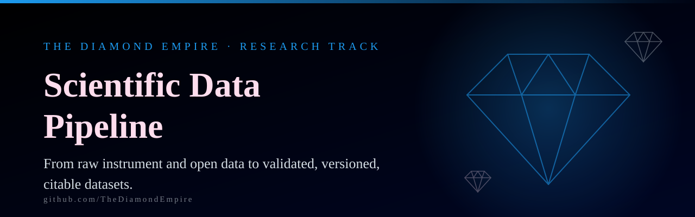
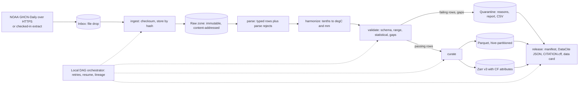

<p align="center"></p>

<p align="center">
  
  
  
</p>

# Scientific Data Pipeline

> From raw instrument and open data to validated, versioned, citable datasets.

An orchestrated pipeline that ingests raw scientific data, validates it against explicit expectations, records full provenance, and publishes versioned, FAIR-style datasets. Re-running the pipeline on the same inputs gives byte-identical outputs (tested, see the research report). It runs locally on a small real dataset (NOAA GHCN-Daily station files); nothing is deployed or published anywhere.

**Quick links:** [Architecture](#architecture) · [Tech stack](#tech-stack) · [Engineering decisions](#engineering-decisions) · [Measured results](#measured-results) · [Roadmap](#roadmap) · [Getting started](#getting-started) · [Case study](docs/case-study.md) · [Research report](docs/research-report.md)

> **Public showcase.** This repository holds the documentation, client case study, research report and measured results for this product. The runnable source code is distributed separately under a license: see [SOURCE-ACCESS.md](SOURCE-ACCESS.md).

## At a glance

|  |  |
|---|---|
| **Track** | Research · Advanced |
| **Phase** | Beta: all five roadmap milestones work locally, the test suite passes and every experiment has a recorded result. Not deployed, not run in production, CI workflow written but never executed. |
| **Primary reader** | Researchers and technical reviewers |
| **Read next** | [README](README.md) · [Client case study](docs/case-study.md) · [Research report](docs/research-report.md) |

## Why this exists

Research data is cleaned in notebooks nobody can rerun. Silent unit errors, gaps and format drift contaminate results, and no one can say which raw files and code versions produced a figure.

## What it does (built and tested)

- Ingestion from a file-drop inbox, plus an HTTPS downloader with retry and SHA-256 checksums (used for NOAA GHCN-Daily)
- Immutable, content-addressed raw zone on the local filesystem (read-only objects, re-hashed on read and by `verify-raw`)
- Typed data contracts (column names, Arrow types, nullability, version) checked on every stage boundary
- Validation rules in three groups: schema (closed domains, unit label, finite values, date window, key uniqueness, source QC flag), range (physical bounds, TMAX not below TMIN, completeness of expected days) and statistical (robust day-of-year z-score)
- Quarantine: failing rows are kept with rule id and reason, never silently dropped; missing days are listed separately as gaps; a read-only HTML report and CSV files for review
- Lineage for every stage: input hashes, code content hash, parameters, contract versions, environment, metrics; split into a deterministic core and a volatile run log
- Curated outputs: Parquet partitioned by station and year, and a Zarr v3 array store (station by time) with CF attributes
- Local DAG orchestrator with retries and resumable stages (a stage is skipped only if its inputs, code, parameters and recorded output hashes are unchanged)
- Versioned immutable releases: DataCite-style JSON, `CITATION.cff`, data card, manifest of file hashes, `verify-release`
- Synthetic fault injection (unit, range, gap, drift, duplicate) with ground truth, used by the fault-injection tests and experiments E1 and E2

## Architecture



Every arrow between stages is a data contract; the lineage records the hash of every artefact a stage used and generated.

## Tech stack

| Layer | Technology actually used |
|---|---|
| Orchestration | Own lightweight local DAG orchestrator (`src/sdp/orchestrator.py`). Dagster and Prefect were not installed or evaluated; a small orchestrator was enough and avoids a heavy dependency on the Windows development machine |
| Compute | Python 3.12, NumPy, pandas, PyArrow, DuckDB (queries in tests and the format study), xarray |
| Validation | Own typed contracts (PyArrow schemas) and own rule engine; pandera and Great Expectations are not used |
| Storage | Local filesystem as a stand-in for object storage (no S3 or MinIO); Parquet (zstd) and Zarr v3 (zstd) |
| Versioning | Content-addressed raw zone, SHA-256 manifests per release; no DVC or lakeFS |
| Metadata | DataCite-style JSON (not schema-validated, no DOI minted), CITATION.cff (validated with `cffconvert`), CF attributes checked by a minimal own checker |
| Reporting | Static HTML report served read-only by the standard library (`sdp serve`) |
| Quality | pytest, hypothesis, mypy strict, ruff, `uv` with a lockfile |
| Delivery | GitHub Actions workflow in `.github/workflows/ci.yml`, written but never run; no Docker (the Docker daemon was not available) |

## Engineering decisions

### Raw data is immutable

Raw inputs are stored once under their SHA-256 and made read-only. Every curated output can be regenerated from them, and the raw zone can be re-verified at any time.

### Quarantine over silent deletion

Rows that fail validation are kept with the rule and reason that rejected them, so a scientist can decide whether the rule or the data is wrong. The measured cost is visible: on real, unmodified data the statistical rule quarantines genuine extreme days (see the research report).

### Determinism is tested

Volatile information (timestamps, durations) is kept out of every hashed artefact. The test suite compares two clean runs, and experiment E5 compares ten runs in separate processes with different hash seeds, thread caps and directories.

### Honest evaluation

Injected faults are synthetic corruptions of real data. Detection rates on them are plumbing and sensitivity checks, not detection rates on real-world defects. Results are reported as measured, including the ones that fail the pre-stated hypotheses.

## Quality bar

- Fault-injection suite: known synthetic corruptions inserted into clean data, detection measured (`tests/test_fault_injection.py`)
- Determinism test: two clean runs must produce identical hashes (`tests/test_pipeline_e2e.py`), plus experiment E5
- Data contracts versioned and enforced at each stage boundary (`tests/test_rawzone_contracts.py`)
- Property-based tests with hypothesis for parsing, hashing, the raw zone, harmonization and fault injection
- Every release ships with a data card and validation summary and can be re-verified with `sdp verify-release`

## Measured results

From one uninterrupted run of `uv run python -m experiments.all` (97 units, 51 minutes, pinned to two cores on a machine at 97 to 100% CPU load from other work, so timings are noisy). Full tables, methods, decision rules and threats to validity are in the [research report](docs/research-report.md); raw data is in `results/`. Faults in E1 and E2 are **synthetic corruptions of real data** (NOAA GHCN-Daily, 8 stations, 2015 to 2019); the grid in E3 is **synthetic**. Detection rates on injected faults are not detection rates on real-world defects.

| Experiment | Headline result | Verdict against the pre-stated hypothesis |
|---|---|---|
| E1 fault detection | Recall 1.000 for range, gap and duplicate faults (detectable by construction); unit faults 0.846 (95% CI 0.843 to 0.850), precipitation unit errors never detected; drift 0.140. Flag rate on unmodified real rows 0.24% | H1 (at least 95% on unit, range, gap) not supported |
| E2 rule-set ablation | Macro recall 0.000 / 0.200 / 0.766 / 0.797 for none / schema / +range / +statistical; the statistical rule adds 0.044 drift recall for 0.24% extra flags on clean real rows | H2 meets its rule, small effect |
| E3 format study | Parquet and Zarr 13.7 to 23.2 times smaller than CSV; warm reads more than 10 times faster in 11 of 12 cells, cold reads mostly not | H3 supported for storage, not as stated for read time |
| E4 provenance overhead | Median wall-clock overhead 29.7% to 51.6% (CI upper bounds 45.7 to 61.6%) on a pipeline of 3 to 7 seconds | H4 (under 5%) not supported |
| E5 determinism | 10 of 10 clean runs identical (Wilson 95% interval 0.72 to 1.00) across hash seeds, thread caps and directories; controls differ as expected | Supported in the tested conditions |


## Roadmap

- [x] M1: ingest and validate one open dataset end to end (GHCN-Daily, checksums, content-addressed raw zone)
- [x] M2: quarantine, reports and lineage capture
- [x] M3: curated Parquet and Zarr outputs with partitioning
- [x] M4: determinism test and fault-injection suite
- [x] M5: versioned release with FAIR-style metadata and citation file

## Not built yet / out of scope

- Object storage (S3 or MinIO): the local filesystem is the only store, because it could not be tested otherwise
- Dagster or Prefect integration: a small own orchestrator is used instead; there is no scheduler, no distributed execution and no UI beyond the static report
- Docker image: the daemon was not available on the development machine
- Spatial validation and a gridded-data validator: the array case is the station-by-time Zarr store; the gridded field in experiment E3 is synthetic and only used for format timing
- DVC or lakeFS versioning: releases are immutable directories with hash manifests
- DOI minting and schema validation of the DataCite record; full CF compliance checking (only a named minimal subset of attributes is checked)
- Other data sources: only the GHCN-Daily fixed-width format has a parser
- A real-world evaluation of the validation rules: detection was measured on injected synthetic faults and on only four real rows carrying a NOAA quality flag
- CI has never run: the workflow file was written to mirror the local commands but nothing was pushed anywhere

## Getting started

> _These instructions refer to the source package, which is distributed separately and is not part of this showcase repository._

Requires [uv](https://docs.astral.sh/uv/) (Python 3.12 is installed by uv). Commands were run on Windows 11 from a short path (Windows path-length limits can break native packages in deep folders).

```bash
uv sync                          # create the locked environment
uv run sdp fetch                 # download the GHCN-Daily extract from NOAA into data/inbox/ghcn
# or, offline, copy the checked-in extract instead:
uv run sdp fetch --offline
uv run sdp run --workdir data/work/demo     # ingest -> parse -> harmonize -> validate -> curate -> release
uv run sdp run --workdir data/work/demo     # second invocation: every stage is resumed, nothing recomputed
uv run sdp lineage --workdir data/work/demo # stage graph, hashes and metrics
uv run sdp verify-raw --workdir data/work/demo
uv run sdp verify-release data/work/demo/release/v0.1.0
uv run sdp serve --workdir data/work/demo   # read-only report at http://127.0.0.1:8765/ (Ctrl+C to stop)
```

These commands were run from a clean copy at a short path: a live download on the same day as the checked-in extract gave byte-identical extract files and the same release data hash, and `pytest` passed there (112 tests; ruff and mypy clean).

On a machine where Python HTTPS aborts because `SSLKEYLOGFILE` points at a filter-driver path, the downloader clears that variable and, on Windows, loads the system root certificates in memory; certificate verification stays on.

Run every experiment in one resumable invocation (about one to two hours on a shared machine; it writes `results/`):

```bash
uv run python -m experiments.all            # add --fresh for a clean run; re-run the same command to resume
uv run python -m experiments.e1             # or one experiment at a time (e1 to e5)
```

## Verification

> _These instructions refer to the source package, which is distributed separately and is not part of this showcase repository._

```bash
uv run ruff check .
uv run ruff format --check .
uv run mypy
uv run pytest                    # includes slow end-to-end tests; about five minutes on a loaded machine
```

The CI workflow runs exactly these commands but has not been executed.

## Repository layout

> _These instructions refer to the source package, which is distributed separately and is not part of this showcase repository._

```
src/sdp/            the package: ghcn, rawzone, contracts, rules, quarantine, lineage, orchestrator,
                    curate, cf, release, report, faults, scoring, stats, synth, cli
experiments/        E1 to E5, shared infrastructure (common.py), runner (all.py), table renderer
tests/              unit, property, end-to-end, fault-injection and hygiene tests; tests/fixtures/ghcn
                    is the checked-in real data extract with its source description
configs/            default pipeline configuration (TOML)
docs/               case study and research report
results/            raw per-unit results, summaries, tables and run metadata of the experiment run
.github/workflows/  ci.yml (not executed)
data/               generated or downloaded data (git-ignored; recreate with the commands above)
```

## Skills demonstrated

`Data engineering` · `Data quality and validation design` · `Provenance and reproducibility` · `Geospatial / array data handling` · `Workflow orchestration` · `FAIR data practice`

## One project, three lenses

The same project is documented for three audiences, so one body of work serves every goal.

| If you are… | Read | You will find |
|---|---|---|
| Hiring or reviewing engineers | [This README](README.md) | Architecture, trade-offs, quality bar and what I would defend in a design review |
| A client or founder | [Client case study](docs/case-study.md) | The business problem, the value levers, how it is measured and how an engagement runs |
| A researcher or technical reviewer | [Research report](docs/research-report.md) | Hypotheses, methods, statistical plan, measured results and the reproducibility checklist |

## Author

Built by **[The Diamond Empire](https://thedempire.shop/)**.
