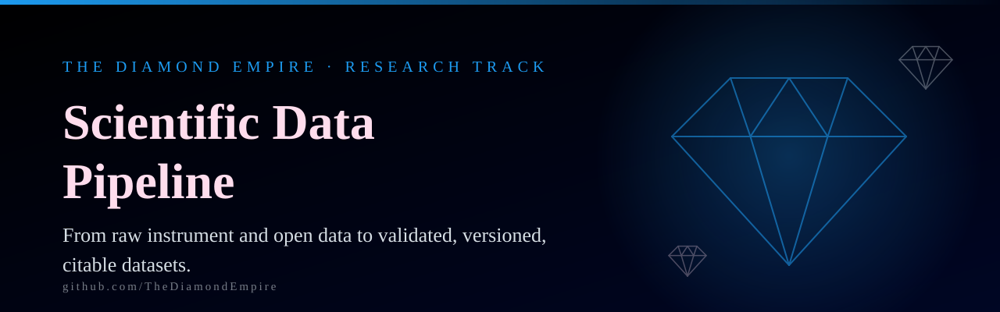

# Scientific Data Pipeline: Client Case Study

> Trustworthy data on a schedule, with a record of exactly where every number came from.

> **Status of this document.** This is a reference case study: it sets out the business problem, the solution and the value model. The results table is intentionally blank and is filled in only from measured data (a pilot or a real engagement). No outcome figures are claimed here. The product described exists as a local prototype (see the [README](../README.md) for exactly what is built and what is not); it has not been used in any client engagement.

## Snapshot

|  |  |
|---|---|
| **Who it is for** | Research groups, environmental and health agencies and analytics teams that depend on external or instrument data. |
| **Solution** | From raw instrument and open data to validated, versioned, citable datasets. |
| **Track** | Research · Advanced |
| **Delivered by** | The Diamond Empire |

## The challenge

Analysts spend a large share of their time cleaning data, errors are found after publication, and nobody can regenerate last year’s dataset.

## The solution

An orchestrated pipeline that ingests raw scientific data, validates it against explicit expectations, records full provenance, and publishes versioned, FAIR-aligned datasets. Re-running the pipeline on the same inputs must give byte-identical outputs.

What the client gets in practice:

- Ingestion from file drops and HTTPS downloads with checksums and retry; raw files are kept unchanged, addressed by content hash
- Schema and quality validation: closed domains, unit labels, physical ranges, cross-field consistency, temporal gap detection and a robust statistical outlier rule (spatial checks are not built)
- Quarantine for failing records with the rule and reason, and a reviewable HTML and CSV report instead of silent drops
- Columnar and array outputs (Parquet and Zarr) with partitioning
- Lineage: raw input hashes, code content hash, parameters and environment for every stage output
- Versioned, immutable releases with DataCite-style metadata, CF attributes on arrays, a citation file and a data card

## How it creates value

| Value lever | How the solution delivers it | How we measure it |
|---|---|---|
| Analyst time | Cleaning and validation are automated and rerunnable | Hours per dataset refresh |
| Error prevention | Validation catches unit, range and gap problems early | Defects caught before analysis; post-publication corrections |
| Reproducibility | Lineage and determinism make results regenerable | Time to regenerate a prior release |
| Compliance and credit | FAIR-style metadata and DOI-ready citation files support funder and journal requirements (the DOI itself is minted by a registration agency, not by the pipeline) | Datasets meeting funder data-management requirements |

## How an engagement runs

| Phase | What happens |
|---|---|
| Profile | Source inspection and quality baseline |
| Define | Data contracts and validation rules with domain experts |
| Build | Pipeline, lineage and releases |
| Operate | Monitoring and quarterly rule review |

## What the client receives

- Pipeline adapted to the client’s data sources (each new source needs its own parser and expectations; only the GHCN-Daily station format is implemented today)
- Validation rules agreed with domain experts, written as explicit expectations and rule parameters
- Quarantine review workflow
- Versioned releases with data cards
- Runbook and training

## Results

Baseline measurements are taken **before** the solution goes live, and the same measures are taken after, so every change in the table is attributable and honest.

| Measure | How measured | Baseline | After | Change |
|---|---|---|---|---|
| Analyst time | Hours per dataset refresh | — | — | — |
| Error prevention | Defects caught before analysis; post-publication corrections | — | — | — |
| Reproducibility | Time to regenerate a prior release | — | — | — |
| Compliance and credit | Datasets meeting funder data-management requirements | — | — | — |

> **To fill in:** replace each — with measured values and add the measurement window and sample size beneath the table.

## How quality and risk are managed

- Fault-injection suite: known synthetic corruptions inserted into clean data and detection measured (detection rates on injected faults are not detection rates on a client’s real defects; the rule set must be tuned with domain experts on their data)
- Determinism test: two clean runs must produce identical hashes
- Data contracts versioned and enforced at each stage boundary
- Every release ships with a data card and validation summary

## Is this a fit?

Best suited to: research groups, environmental and health agencies and analytics teams that depend on external or instrument data.

## Talk to me

Want this adapted to your business? Get in touch via **[thedempire.shop](https://thedempire.shop/)**.

---

[README](../README.md) · [Client case study](case-study.md) · [Research report](research-report.md)
